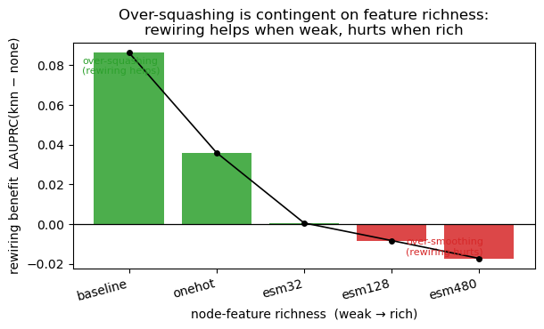
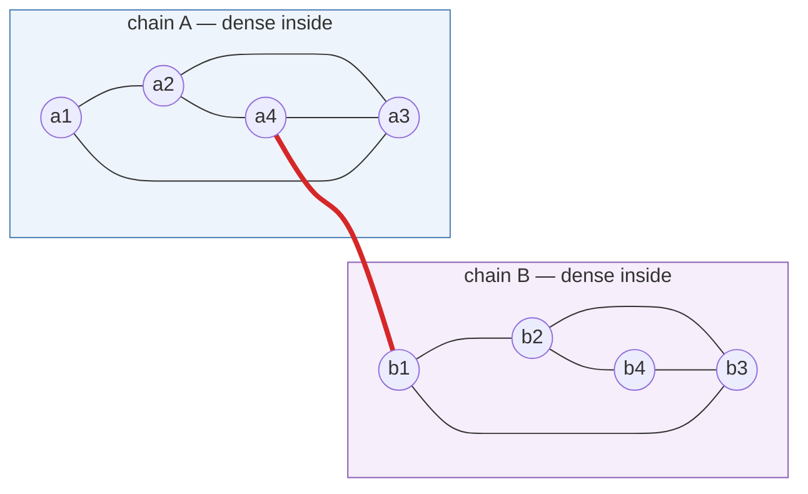
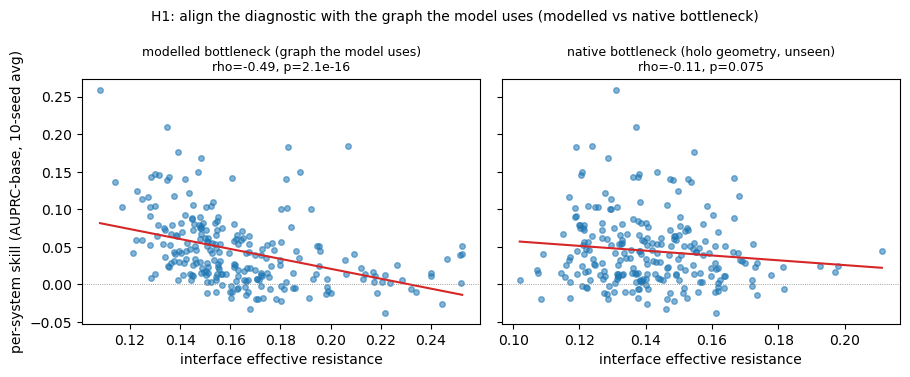
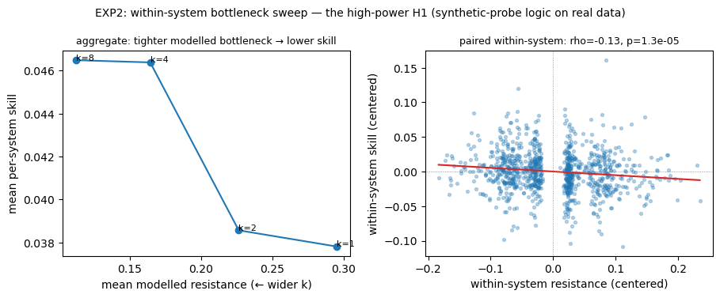
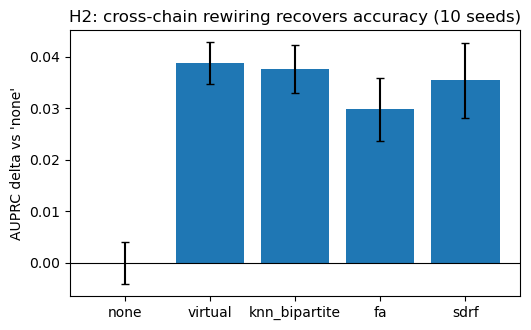
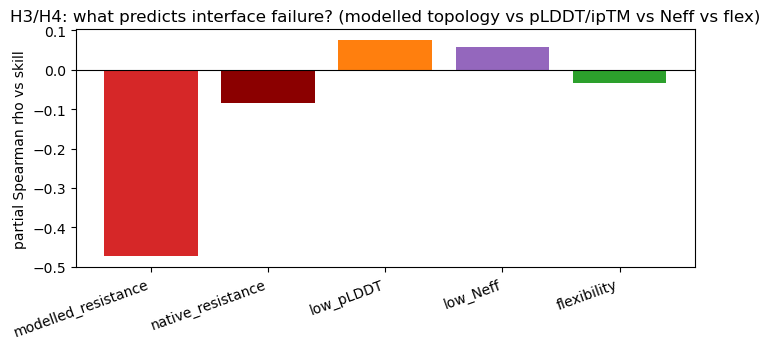
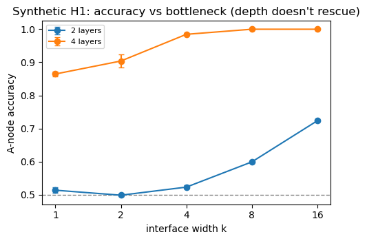
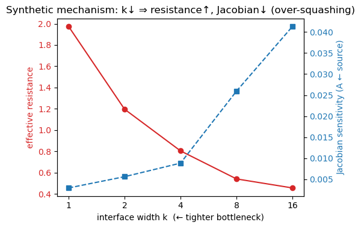
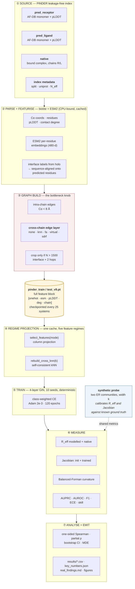

<div align="center">

# Isthmus

### When message passing over-squashes at protein–protein interfaces — and when it does not.

**_Foldable but not dockable_** — an over-squashing account of AlphaFold's interface failures,
measured end-to-end on PINDER's leakage-free split, with **zero folding inference**.

[](https://www.python.org/)
[](https://pytorch.org/)
[](https://pyg.org/)
[](https://developer.nvidia.com/cuda-toolkit)
[](https://github.com/pinder-org/pinder)
[](https://github.com/facebookresearch/esm)
[](#86-reproducibility--determinism)
[](documentation/%5BGRL%5D_Murat_Kolic_miniproject_report.pdf)

[**Headline result**](#3-headline-result-over-squashing-is-contingent-on-feature-richness) ·
[**Architecture**](#5-system-architecture) ·
[**Method spec**](#6-method-specification) ·
[**Tech stack**](#7-tech-stack) ·
[**Reproduce**](#9-reproducing-the-results) ·
[**Decision log**](#10-engineering-decision-log)

</div>

---

## TL;DR

AlphaFold folds each chain confidently but a large fraction of its **complex** predictions are wrong —
the documented *"great monomers, weak complexes"* regime. This project reframes that as a property of
**message-passing GNNs**. A folded chain is internally dense, so intra-chain reasoning has no
bottleneck; the interface between two chains is a narrow **isthmus** of a few contacts through which all
cross-chain signal must squeeze — exactly the topology where message passing **over-squashes**.

I test that claim causally on real data, and find something sharper than the textbook prediction:

> **Over-squashing at the interface is real, but *conditional*.** Holding the architecture fixed and
> varying *only* node-feature richness, the benefit of cross-chain rewiring **flips sign**
> (ΔAUPRC **+0.086 → −0.017**). With weak features the model *must* route across the sparse interface,
> so relieving the bottleneck helps. With rich ESM2 features each residue can be classified locally,
> so the same edges stop relieving a bottleneck and start **over-smoothing** the two chains together.

<div align="center">



</div>

Everything below — the causal rewiring experiment, the two over-squashing diagnostics, the
synthetic-to-real calibration and the statistics protocol — exists to make that one sentence
defensible.

---

## At a glance

|  |  |
|---|---|
| **Task** | Binary node classification — *is this residue on the inter-chain interface?* |
| **Data** | PINDER leakage-free split · **383 train / 243 test** heterodimers |
| **Input** | Two AlphaFold-DB **predicted monomers** (pose-free) + pLDDT — the bound complex is used **only** for labels |
| **Model** | 4-layer **GIN**, 64 hidden, LayerNorm + residuals, ~31k params |
| **Intervention** | 5 cross-chain edge layers: `none` · `knn` · `fa` · `virtual` · `sdrf` |
| **Diagnostics** | Effective resistance `R_eff` · Jacobian sensitivity `‖∂h_v/∂x_u‖` · Balanced-Forman curvature |
| **Protocol** | 10 seeds · deterministic (TF32 off) · bootstrap CIs · pre-registered one-sided tests · MDE |
| **Compute** | 1× NVIDIA A40 (runs on a T4/8 GB) · ~92 training runs · ~1–2 h parse, minutes to retrain |
| **Inference** | **No folding inference anywhere** — the entire study is reproducible on one GPU |
| **Deliverables** | 1 notebook (run end-to-end), 5 result artifacts, 8 figures, a 5-page report |

---

## Contents

1. [Motivation: foldable but not dockable](#1-motivation-foldable-but-not-dockable)
2. [Problem formulation](#2-problem-formulation)
3. [Headline result: over-squashing is contingent on feature richness](#3-headline-result-over-squashing-is-contingent-on-feature-richness)
4. [Hypotheses and results](#4-hypotheses-and-results)
5. [System architecture](#5-system-architecture)
6. [Method specification](#6-method-specification)
7. [Tech stack](#7-tech-stack)
8. [Specifications](#8-specifications)
9. [Reproducing the results](#9-reproducing-the-results)
10. [Engineering decision log](#10-engineering-decision-log)
11. [Repository layout and artifact schemas](#11-repository-layout-and-artifact-schemas)
12. [Validity and limitations](#12-validity-and-limitations)
13. [Related work](#13-related-work)
14. [Roadmap](#14-roadmap)
15. [Citation, license, acknowledgements](#15-citation-license-acknowledgements)
16. [Repository metadata](#16-repository-metadata-github-about--topics)

---

## 1. Motivation: foldable but not dockable

AlphaFold2 and AlphaFold-Multimer changed structural biology for *single chains*. For **complexes**,
benchmarking repeatedly finds the same asymmetry: the individual chains come back near-perfect and
confidently folded (high pLDDT), while a large share of the *assemblies* are placed wrong. The blunt
question is:

> **Why should placing two well-folded chains relative to one another be so much harder than folding
> each of them?**

Answer the question as a graph problem and it stops being mysterious. Represent each chain as a
residue contact graph:



*Intra*-chain reasoning happens inside a dense community — many short paths, no bottleneck. *Inter*-chain
reasoning must pass through the red edge: a narrow **isthmus** of a handful of contacts — a strip so thin
that every cross-chain signal has to cross it, which is what the project is named after. This is the
textbook setting for **over-squashing**: the exponential compression of information forced through a
graph bottleneck (Alon & Yahav 2021; Topping et al. 2022; Di Giovanni et al. 2023; Black et al. 2023).

**The scope claim, stated plainly.** This repository does **not** claim that AlphaFold itself
over-squashes — AlphaFold is not a sparse message-passing network over a contact graph. It takes AF's
documented failure mode as *motivation*, then asks the well-posed GNN question: *when does
over-squashing govern protein–protein interface inference?* The study is run on AF's **interface
sub-task**, with a GNN I own, on PINDER's leakage-free split, using AF's own artifacts (predicted
monomers + pLDDT) as pose-free input and as a *competing explanation*.

---

## 2. Problem formulation

**Given** the two partners of a dimer as AlphaFold-DB **predicted monomers** — each an unbound,
pose-free structure with per-residue pLDDT in the B-factor column — **predict** which residues sit on
the inter-chain interface. The ground truth comes from the **bound (holo) complex**, which the model
never sees as input.

Formally, per system:

- Build a graph `G = (V, E)` where `V` = residues of chain A ∪ residues of chain B.
- `E = E_A ∪ E_B ∪ E_cross`, where `E_A`, `E_B` are intra-chain contact edges (Cα within 8 Å) and
  `E_cross` is a **pose-free** cross-chain edge layer — *the experimental knob*.
- Learn `f_θ : V → {0,1}`, predicting `y_v = 1` iff residue `v` is within 8 Å (all-atom) of the other
  chain in the holo complex.

**Metrics.** Interfaces are imbalanced (mean prevalence ≈ 0.22 on test), so the primary metric is
**AUPRC** (pooled over all test residues), with AUROC, best-threshold F1 and 10-bin **ECE** alongside.
For per-system analysis the base-rate-free quantity is

$$\text{skill}(s) \;=\; \text{AUPRC}(s) \;-\; \text{prevalence}(s)$$

so a system with a 40 % interface is not automatically "easy".

**Why this design is the right compromise.** Grading AlphaFold end-to-end needs DockQ, which needs
folding inference on hundreds of complexes — infeasible here, and irrelevant to the mechanism.
Studying AF's *sub-task* with an owned model keeps every knob controllable (I can *delete* the
bottleneck and retrain) and keeps the whole study reproducible on a single GPU.

---

## 3. Headline result: over-squashing is contingent on feature richness

The textbook prediction is simple: rewiring relieves a bottleneck, so it should help. It holds only in
a specific regime. Holding the GNN architecture fixed and varying **only** the per-residue node
features along a richness ladder — each regime self-consistent, its cross-chain kNN layer rebuilt from
its *own* feature space — the benefit of cross-chain rewiring **flips sign**:

| node features | dim | `none` AUPRC | `knn` AUPRC | **ΔAUPRC (knn − none)** | regime |
|---|---:|---:|---:|---:|---|
| baseline (degree + pLDDT) | 3 | 0.209 | 0.295 | **+0.086** | 🟢 over-squashing |
| one-hot amino acid | 24 | 0.196 | 0.232 | **+0.036** | 🟢 over-squashing |
| ESM2-32 | 35 | 0.201 | 0.202 | **+0.001** | ⚪ crossover |
| ESM2-128 | 131 | 0.219 | 0.211 | **−0.008** | 🔴 over-smoothing |
| ESM2-480 | 483 | 0.223 | 0.206 | **−0.017** | 🔴 over-smoothing |

<sub>3 seeds per cell, same graphs, same architecture, same optimiser — the *only* thing that changes is
which feature columns the GNN sees.</sub>

**Reading.** With weak features the model cannot identify interface residues locally, so it **must**
route signal across the sparse interface — and the neck over-squashes it; adding cross-chain edges
relieves that and helps a lot. With rich ESM2 features each residue already carries enough
evolutionary/structural context to be classified locally, so the same edges no longer relieve a
*needed* bottleneck and instead mildly **over-smooth** the two chains together, hurting slightly.

**Why this matters beyond proteins.** Over-squashing is usually reported as a property of the *graph*.
This is a controlled demonstration that it is a property of the **graph × task × feature** triple: the
same topology is a harmful bottleneck or a useful separation depending on how much of the task the node
features already solve. That reframes "should I rewire?" as an empirical question about feature
richness, not a topological one.

The causal experiments below are therefore run in the weak (`onehot`) regime — **the regime where the
bottleneck binds**, stated up front rather than discovered post hoc.

---

## 4. Hypotheses and results

| | prediction | observed | verdict |
|---|---|---|---|
| **H0** | rewiring benefit depends on feature richness | ΔAUPRC flips +0.086 → −0.017 | ✅ **supported (crossover)** |
| **H1** | skill ↓ as modelled resistance ↑ | ρ = −0.49 cross-system; −0.13 within-system | ✅ **supported** |
| **H2** | rewiring recovers accuracy (causal) | all rewirings > `none`; Jacobian relieved | ✅ **supported (causal)** |
| **H3** | topology beats AlphaFold's confidence | modelled −0.47 vs. pLDDT +0.075 | ✅ **supported** |
| **H4** | flexibility / N_eff compete | neither predicts failure | ⚪ negative (informative) |
| **H5** | link holds on the de-leaked test split | monotone test tertiles, gated on H1 | ✅ **supported (directional)** |

### 4.1 H1 — the *modelled* bottleneck predicts failure

The key design decision is *which* bottleneck to correlate with failure. Rather than the **native**
resistance (holo contact graph — geometry the model never sees), the primary metric is the **modelled**
resistance: effective resistance on the model's *own* pose-free input graph, between the true-interface
residues of the two chains. That is the bottleneck the network actually routes through.

<div align="center">



</div>

| bottleneck | Spearman ρ vs skill | one-sided p | 95 % CI | note |
|---|---:|---:|---|---|
| **modelled** (graph the model uses) | **−0.490** | 2.1 × 10⁻¹⁶ | [−0.59, −0.39] | sign-stable across all 10 seeds |
| native (holo geometry, unseen) | −0.114 | 0.075 | — | weak, *as it must be* |
| native, on the relieved `virtual` model | −0.386 | 4.8 × 10⁻¹⁰ | — | contrast |

The **within-system sweep** (EXP2) confirms it at much higher power. Per system I sweep the modelled
cross-chain width `k ∈ {1,2,4,8}` and centre both quantities *within each system* — a paired design that
removes between-system nuisance variance, and is exactly the synthetic probe's logic transplanted onto
real data:

<div align="center">



</div>

ρ = **−0.134** (one-sided p = 1.3 × 10⁻⁵, 95 % CI [−0.19, −0.07], **972 system–k points** over 243
systems); each system's own slope is negative in **57 %** of systems. Aggregate means by width:

| cross-chain width `k` | 1 | 2 | 4 | 8 |
|---|---:|---:|---:|---:|
| mean modelled resistance | 0.295 | 0.226 | 0.164 | 0.112 |
| mean per-system skill | +0.038 | +0.039 | +0.046 | +0.046 |

### 4.2 H2 — cross-chain rewiring is causal, and it works by relieving squashing

Five cross-chain edge layers, identical everything else, 10 seeds, weak (`onehot`) regime:

| rewiring | AUPRC | ± | AUROC | best-F1 | ECE | **ΔAUPRC vs `none`** |
|---|---:|---:|---:|---:|---:|---:|
| `none` (disconnected chains) | 0.194 | 0.004 | 0.528 | 0.292 | 0.084 | — |
| `knn` (embedding-similarity bipartite) | 0.232 | 0.005 | 0.589 | 0.325 | 0.039 | **+0.038** |
| `fa` (fully-adjacent final layer) | 0.224 | 0.006 | 0.566 | 0.312 | 0.048 | **+0.030** |
| `sdrf` (curvature-targeted, ~48 edges) | 0.230 | 0.007 | 0.584 | 0.322 | 0.040 | **+0.035** |
| `virtual` (global hub node) | **0.233** | 0.004 | **0.589** | 0.325 | **0.038** | **+0.039** |

<div align="center">



</div>

Two things make this a *mechanism* claim rather than a "more edges help" claim:

1. **`knn`, `fa` and `sdrf` add cross edges without a global hub**, so their gain over `none` isolates
   bottleneck relief rather than the virtual node's extra capacity.
2. **The Jacobian confirms it directly on the trained models** (EXP3): the cross-interface sensitivity
   `‖∂h_A/∂x_B‖` measured between true-interface residues.

| rewiring | `none` | `knn` | `fa` | `virtual` | `sdrf` |
|---|---:|---:|---:|---:|---:|
| cross-interface Jacobian | **0.0** | 4.78 × 10⁻² | 5.78 × 10⁻² | 1.90 × 10⁻² | 1.76 × 10⁻² |

`none` is chain-disconnected, so its cross-interface gradient is **identically zero** — maximal
squashing, measured, not assumed. Every cross-wired variant carries real interface signal. (`virtual`
and `sdrf` route through a hub / a few supporting edges, so their *direct* residue-to-residue
sensitivity is lower than `knn`/`fa` while their accuracy is equal — different relief geometries, same
outcome.)

Calibration moves with it: ECE drops from **0.084** (`none`) to **0.038** (`virtual`). A squashed model
is not just less accurate, it is *overconfident*.

**Parsimony.** `sdrf` — curvature-targeted rewiring that adds a triangle-forming support edge only at
the most negatively curved necks — matches `fa` and `virtual` while adding **~48 edges per system**,
against `fa`'s complete final layer (O(N²)) and `virtual`'s N-edge hub. The right *inductive bias*
beats brute-force connectivity.

### 4.3 H3 / H4 — topology beats confidence, and the honest alternatives lose

<div align="center">



</div>

| predictor of per-system skill | partial Spearman ρ | p |
|---|---:|---:|
| **modelled resistance** (topology) | **−0.473** | 5.6 × 10⁻¹⁵ |
| native resistance | −0.085 | 0.18 |
| low pLDDT (AlphaFold monomer confidence) | +0.075 | 0.25 |
| low N_eff (co-evolution depth) | +0.058 | 0.37 |
| flexibility (predicted→holo Cα-RMSD) | −0.034 | 0.59 |

The topology term is an **order of magnitude** larger than the strongest confidence term. Monomers are
confidently folded even where interface reasoning fails: **confidence is not the bottleneck, cross-chain
topology is.** H4's competing explanations — conformational change on binding, and co-evolutionary
signal depth — are measured and *do not* explain failure here; reported as a clean negative.

> **One honest caveat.** AlphaFold-Multimer's *complex* confidence (ipTM / interface PAE) would be the
> fairer contest, but PINDER's index does not expose it per system (`iptm` is `NaN` for all 243 test
> systems; the code probes for it and degrades gracefully). The confidence baseline here is therefore
> the weaker monomer pLDDT.

### 4.4 H5 — the link survives the de-leaked split

Stratifying **test** skill by modelled-resistance tertile gives a monotone decline
(**0.073 → 0.035 → 0.025**). With ~81 systems per tertile and no trend test, that is read as
*directional*; the powered continuous H1 on the same split is the same claim done properly, and it is
significant — which is what ties over-squashing to **out-of-distribution generalisation** on a
leakage-free benchmark.

### 4.5 The synthetic probe — the metrics are calibrated before they are trusted

Every diagnostic used on PINDER is first validated on a graph where ground truth is known: two
Erdős–Rényi communities (16 nodes each) joined by exactly `k` cross-edges, with a source label placed
in B and read out at the A nodes, so the task **requires** cross-interface flow.

<div align="center">




</div>

| `k` (interface width) | 1 | 2 | 4 | 8 | 16 |
|---|---:|---:|---:|---:|---:|
| effective resistance | 1.975 | 1.196 | 0.804 | 0.540 | 0.456 |
| Jacobian sensitivity | 2.9 × 10⁻³ | 5.6 × 10⁻³ | 8.8 × 10⁻³ | 2.6 × 10⁻² | 4.1 × 10⁻² |
| accuracy (4 layers) | 0.865 | 0.904 | 0.985 | 1.000 | 1.000 |
| accuracy (2 layers) | 0.513 | 0.498 | 0.523 | 0.599 | 0.723 |

Spearman(resistance, accuracy) = **−0.97**; Spearman(Jacobian, accuracy) = **+0.97**. And note the
2-layer row: **depth does not rescue a tight bottleneck** — a 2-layer model is at chance for every `k`
because the *task* needs more hops than it has, while at 4 layers the *topology* becomes the binding
constraint. The same two metrics then carry over to PINDER, which is what makes the real-data
correlations interpretable instead of decorative.

---

## 5. System architecture

The whole study is a single, resumable, cache-versioned pipeline. Parsing (network + Laplacian
pseudo-inverses) is CPU-bound and slow; everything after it is a cheap replay from a `.pt` cache, which
is what makes ~92 training runs practical.



**Design principles baked into the pipeline**

| principle | how it shows up |
|---|---|
| **One expensive parse, many cheap experiments** | The cache stores the *union* of all feature blocks; every regime is a column projection + kNN rebuild, never a re-parse. |
| **The diagnostic must match the graph the model uses** | `model_iface_reff` is recomputed on the *regime* graph, not on the holo geometry. |
| **The intervention is a single swappable layer** | `add_rewiring()` re-derives any cross-chain layer from one cached graph; labels untouched. |
| **Failure is skipped, counted, and explained** | Degenerate systems raise, are logged with a reason, and never silently corrupt a split. |
| **Long runs survive disconnects** | `.part` checkpoints every 25 systems; SMOKE/FULL caches are namespaced so a smoke subset can never leak into a full run. |
| **Environments are hostile; assert early** | The install cell verifies the C-ABI-sensitive stack *before* a 1–2 h parse, not after. |

---

## 6. Method specification

### 6.1 Data selection

| step | rule | rationale |
|---|---|---|
| index | `pinder.core.get_index()` | 1.56 M train / 1 955 test systems |
| availability | `predicted_R == True and predicted_L == True` | both partners must ship an AF-DB monomer, else the system has no input |
| **heterodimers only** | `uniprot_R != uniprot_L` | homodimers returned overlapping holo coordinates → ~95 % spurious interface labels → a degenerate task |
| sample | 400 train / all 254 available test, seeded permutation, cached to JSON | fixed subset, reproducible across sessions |
| degeneracy guard | skip if prevalence > 0.6 or < 0.02 | catches symmetry-copy overlaps (prevalence ≈ 1) and failed alignments (≈ 0) |
| **result** | **383 train / 243 test** | 4 % / 4 % skipped, each logged with its reason |

Test-split descriptive statistics (`results/per_system.csv`, n = 243):

| | nodes | interface residues | prevalence | modelled `R_eff` | native `R_eff` | mean pLDDT | flexibility (Å) |
|---|---:|---:|---:|---:|---:|---:|---:|
| mean | 831 | 150 | 0.218 | 0.164 | 0.141 | 83.9 | 3.01 |
| median | 759 | 133 | 0.189 | 0.156 | 0.139 | 86.0 | 1.48 |
| range | 162–1500 | 52–576 | 0.035–0.594 | 0.108–0.252 | 0.102–0.211 | 54–98 | 0.17–28.1 |

### 6.2 Graph construction

**Nodes** = residues (one per Cα). **Node feature layout** — the cache stores the union so every regime
is a column slice; the chain indicator stays **last** so rewiring code can always find it at `[-1]`:

```
┌──────────────┬──────────────────┬────────┬────────┬───────┐
│ one-hot (21) │  ESM2 (480)      │ pLDDT  │ degree │ chain │   ← cached layout, 504 columns
└──────────────┴──────────────────┴────────┴────────┴───────┘
   └── residue identity            /100     norm.    0 = A
                                                     1 = B
```

| regime | columns kept | `in_dim` |
|---|---|---:|
| `baseline` | pLDDT + degree + chain | 3 |
| `onehot` | + residue one-hot | 24 |
| `esm32` / `esm128` / `esm480` | + first *d* ESM2 dims | 35 / 131 / 483 |
| `all` | one-hot + full ESM2 | 504 |

- **pLDDT** is read from the B-factor column of the AF-DB monomer — AlphaFold's own confidence, used as
  a feature *and* as the competing explanation in H3.
- **Contact degree** (normalised) is a cheap burial signal: interface residues are surface-exposed and
  therefore lower-degree. It is the reason the 3-dimensional `baseline` regime is not hopeless.
- **ESM2** = `esm2_t12_35M_UR50D`, last-layer per-residue representations, chains longer than 1 022
  residues chunked to the model's positional budget.

**Edges.**

| edge type | rule |
|---|---|
| intra-chain | Cα–Cα distance ≤ 8 Å, within a chain |
| cross-chain | the experimental knob (§6.3) — **never** a 3-D inter-chain distance |

The cross-chain layer is **pose-free by construction**. Unbound monomers have no relative pose, so
using inter-chain geometry would leak the answer. Candidate cross edges come from *feature similarity*
only.

**Labels.** Interface = within 8 Å (all-atom) of the other chain in the **holo** complex, computed on
`ps.native` (chains `R`/`L`), then transferred onto the predicted residue set by **optimal global
sequence alignment** (biotite, BLOSUM, affine gap −10/−1), because predicted and experimental residue
numbering differ. Gap positions are counted as mismatches and stored per system.

**Cropping.** Only when a graph exceeds `MAX_NODES = 1500`: keep interface residues + a 2-hop graph
shell. Cropping *by default* was tried and rejected — it inflates the interface fraction toward 1 and
makes the task trivially solvable by predicting all-positive.

### 6.3 The bottleneck knob — five cross-chain edge layers

| variant | construction | edges added / system | what it isolates |
|---|---|---|---|
| `none` | no cross edges — chains fully disconnected | 0 | **maximal squashing** (cross-interface Jacobian ≡ 0) |
| `knn` | bipartite kNN on node-feature cosine similarity, `k = 4` each way | O(k·N) | bottleneck relief, pose-free, no hub |
| `fa` | last layer runs on the complete graph | O(N²) at layer 4 only | relief via unlimited final-layer mixing |
| `virtual` | one global hub node wired to every residue | 2N | relief **+** extra capacity (deliberately confounded, as a ceiling) |
| `sdrf` | rank cross edges by **Balanced-Forman curvature**, add a triangle-forming support edge at the most negative ones | **~48** | *curvature-targeted* relief — the parsimony claim |

`fa` builds an N² edge index, which is a GPU-memory bomb on 1 500-node graphs; `FA_MAX_NODES = 700`
caps it, and graphs above the cap keep their sparse edges (degrading gracefully instead of OOM-ing).

### 6.4 Model

```
x ∈ R^(N×F)
   │
   ├─► GINConv(F → 64)   ─► LayerNorm ─► ReLU ────────────────┐   layer 1
   ├─► GINConv(64 → 64)  ─► LayerNorm ─► ReLU ─► ( + residual )┤   layer 2
   ├─► GINConv(64 → 64)  ─► LayerNorm ─► ReLU ─► ( + residual )┤   layer 3
   ├─► GINConv(64 → 64)* ─► LayerNorm ─► ReLU ─► ( + residual )┘   layer 4   (* complete graph if fa)
   │
   └─► Linear(64 → 2)  ─►  per-residue logits
```

`GINConv` MLP = `Linear(i,o) → ReLU → Linear(o,o)`. GCN / SAGE / GAT sit behind the same class and are
used in the synthetic probe.

| `in_dim` | 3 | 24 | 35 | 131 | 483 |
|---|---:|---:|---:|---:|---:|
| parameters | 30 018 | **31 362** | 32 066 | 38 210 | 60 738 |

**Why LayerNorm and residuals are not decoration:** a plain 4-layer GIN (sum aggregation) on these
large sparse graphs collapsed to a constant output — AUROC exactly 0.500. LayerNorm bounds the
activations, the hidden→hidden residuals keep gradients and node identity alive. Both are disabled for
the tiny synthetic graphs so that probe stays byte-identical to its original form.

### 6.5 Training protocol

| | |
|---|---|
| loss | class-weighted cross-entropy, weight `[1, min(neg/pos, 3.0)]` |
| **class-weight cap** | `3.0` — the raw ≈5× ratio drove the degenerate all-positive optimum |
| optimiser | Adam, `lr = 2e-3`, `weight_decay = 1e-5` |
| schedule | 120 epochs, one graph per step, systems shuffled every epoch |
| batching | full-graph per system (variable N); no mini-batching over nodes |
| masking | only real residues contribute to the loss (the `virtual` hub node is excluded) |
| seeds | **10** for H1/H2/EXP3, 3 for the k-sweep and the feature ladder |
| eval | pooled over all test residues + per-system F1/AUPRC/AUROC/skill |

Per seed that is 383 × 120 ≈ **46 k** forward/backward passes; the full study is ≈ **92 training runs**
(5 rewirings × 10 seeds + 4 widths × 3 seeds + 5 regimes × 2 rewirings × 3 seeds).

### 6.6 Over-squashing diagnostics

**Effective resistance** — the canonical bottleneck measure (Black et al. 2023), computed from the
Laplacian pseudo-inverse:

$$R_{\text{eff}}(u,v) \;=\; L^{\dagger}_{uu} + L^{\dagger}_{vv} - 2L^{\dagger}_{uv}$$

averaged over sampled true-interface pairs (u ∈ A, v ∈ B), ≤ 80 pairs per system. Two variants are
computed and *kept distinct*:

| metric | graph | role |
|---|---|---|
| **`model_iface_reff`** | the model's own pose-free input graph | **primary** — the bottleneck the network routes through |
| `iface_reff` | holo inter-chain contact graph (≤ 10 Å) | contrast — geometry the model never sees |
| `cross_reff` | label-free random A–B pairs on the input graph | reference |

**Jacobian sensitivity** — the input-to-output propagation measure (Topping et al. 2022; Di Giovanni
et al. 2023):

$$J(u \to v) \;=\; \left\lVert \frac{\partial h_v}{\partial x_u} \right\rVert$$

measured two ways: over **freshly initialised** models (an architecture property, avoiding trained-ReLU
saturation artifacts) for the synthetic probe, and **across the interface on the trained models** for
EXP3 (10 source × 10 target true-interface residues per system).

**Balanced-Forman curvature** drives `sdrf` and is reported for cross edges — negatively curved edges
are the necks.

### 6.7 Statistics protocol

Weak correlations invite wishful reading, so the protocol is fixed in advance and reported in full:

| device | why |
|---|---|
| **pre-registered one-sided tests** | the sign is predicted a priori (tighter bottleneck → lower skill), so the one-sided test is the correct and more powerful one |
| **bootstrap CIs** (2 000 resamples over systems) | reports an interval, not a bare p |
| **partial Spearman** | H3/H4 compare topology against pLDDT / N_eff / flexibility with the others residualised out |
| **per-seed sign stability** | all 10 per-seed ρ values are reported, not just their mean |
| **minimum detectable effect** | MDE = **0.159** at n = 243 (α = .05, power = .8, one-sided) — so a null is reported as *bounded*, not as *absent* |
| **paired within-system design** | EXP2 centres skill and resistance within each system, removing between-system variance |

---

## 7. Tech stack

| layer | technology | version | role |
|---|---|---|---|
| language | Python | 3.11 | — |
| deep learning | PyTorch | 2.8.0+cu128 | model, autograd (the Jacobian diagnostics *are* autograd) |
| graph learning | PyTorch Geometric | 2.8.0 | `Data`, `GINConv` / `GCNConv` / `SAGEConv` / `GATConv` |
| graph analysis | NetworkX | 3.x | Laplacian, effective resistance, connectivity, curvature |
| structural bio | **biotite** | 1.x | mmCIF/PDB parsing, amino-acid filters, optimal sequence alignment |
| protein LM | **fair-esm** | `esm2_t12_35M_UR50D` | 480-d per-residue embeddings (the richness ladder) |
| dataset | **pinder** | `pinder.core` | leakage-free index, per-system predicted / apo / holo triples |
| numerics | NumPy · SciPy | 2.3.5 · 1.x | `pinv`, Spearman, Fisher-z power analysis |
| metrics | scikit-learn | 1.x | AUPRC, AUROC, F1 |
| dataframes | pandas | 2.x | per-system tables, LaTeX export |
| plotting | Matplotlib | 3.x | all 8 figures |
| environment | Jupyter · CUDA 12.8 | — | Colab / Kaggle / SLURM cluster, one notebook |
| report | LaTeX (`pdflatex`) | — | 5-page report, macros auto-filled from `key_numbers.json` |

**Why these.** PyG for the standard conv zoo behind one interface; NetworkX because the diagnostics are
spectral graph theory, not tensor ops, and correctness beats speed on 800-node graphs; biotite over
Biopython for a NumPy-native atom-array API and a built-in optimal aligner; the 35 M ESM2 rather than
650 M because the richness *ladder* matters more than the top of it, and it fits a T4 next to the
training job.

---

## 8. Specifications

### 8.1 Configuration reference (`CONFIG`, notebook cell 5)

| key | value | meaning |
|---|---|---|
| `SMOKE` | `False` | `True` → ~20 systems, minutes, end-to-end sanity run |
| `N_SYSTEMS` | `400` | train systems requested before skips |
| `INTERFACE_THRESH` | `8.0` Å | holo all-atom cutoff defining interface labels |
| `EDGE_THRESH` | `8.0` Å | intra-chain Cα contact edges |
| `KNN` | `4` | cross-chain kNN width (pose-free candidates) |
| `CROP_HOPS` / `MAX_NODES` | `2` / `1500` | crop radius, and the size above which cropping triggers |
| `HID` / `LAYERS` / `EPOCHS` | `64` / `4` / `120` | GIN capacity and schedule |
| `SEEDS` | `range(10)` | 10 seeds main, 3 for sweeps |
| `REWIRINGS` | `[none, virtual, knn_bipartite, fa, sdrf]` | the causal intervention set |
| `KNN_SWEEP` | `[1, 2, 4, 8]` | within-system bottleneck widths (EXP2) |
| `USE_ESM` / `ESM_MODEL` | `True` / `esm2_t12_35M_UR50D` | cache ESM2 alongside one-hot |
| `MAIN_FEATURES` | `"onehot"` | regime for the causal experiments — the weak regime where the bottleneck binds |
| `RICHNESS_LADDER` | `[baseline, onehot, esm32, esm128, esm480]` | the headline sweep |
| `DETERMINISTIC` | `True` | deterministic algorithms, TF32 off |
| `FA_MAX_NODES` | `700` | cap on `fa`'s complete-graph layer (lower to 500 on 8 GB) |

### 8.2 Hardware and runtime

| | reference run | minimum |
|---|---|---|
| GPU | NVIDIA **A40** (48 GB) | T4 / any 8 GB CUDA card (`FA_MAX_NODES = 500`) |
| first parse | **~1–2 h**, CPU-bound (per-system downloads + Laplacian `pinv`) | same |
| retrain from cache | minutes per experiment block | same |
| disk | ~2–5 GB PINDER scratch + a few hundred MB of `.pt` cache | — |
| network | required for the first parse only | — |

The GPU is *not* the bottleneck — parsing is. That is why the cache, the `.part` checkpoints and the
column-projection regime design exist.

### 8.3 Storage and cache layout

```
$GRL_CACHE_DIR/                     # or Drive on Colab, /kaggle/working on Kaggle
├── pinder/                         # PINDER_BASE_DIR — raw per-system structures (scratch, large)
├── subset_ids_v3_{full,smoke}.json # the frozen system list
├── pinder_{train,test}_v9.pt       # parsed graphs + all per-system diagnostics  ← the expensive artifact
├── pinder_*.pt.part                # resume checkpoint, written every 25 systems
├── figures/                        # fig2 … fig8
└── results/                        # the files mirrored into results/ in this repo
```

Cache filenames are **version-tagged** (`v9`): any change to the feature layout bumps the tag and forces
a clean re-parse rather than silently mixing incompatible caches.

### 8.4 Metrics reported

`AUPRC` (primary, pooled) · `AUROC` · `F1@0.5` and best-threshold `F1` · `ECE` (10 bins,
confidence-binned) · per-system `skill = AUPRC − prevalence` · `Spearman ρ` (one-sided, bootstrapped,
partial) · cross-interface Jacobian · effective resistance (modelled / native / label-free).

### 8.5 Failure handling

| condition | behaviour |
|---|---|
| missing predicted monomer | system skipped, reason logged |
| degenerate prevalence (> 0.6 or < 0.02) | skipped with the holo centroid distance printed |
| empty chain after crop / no interface | skipped |
| ESM unavailable | graceful fallback to residue one-hot, run continues |
| ipTM/PAE absent from index | `NaN`, H3 falls back to pLDDT with an explicit note |
| `fa` graph over the node cap | keeps sparse edges instead of OOM-ing |
| disconnected A–B pair in `R_eff` | pair dropped; all-disconnected → `inf` (`none` by design) |

### 8.6 Reproducibility / determinism

- `torch.use_deterministic_algorithms(True, warn_only=True)`, `CUBLAS_WORKSPACE_CONFIG=:4096:8`
- **TF32 off** on matmul and cuDNN; `cudnn.deterministic = True`, `benchmark = False`
- every experiment re-seeded via `set_seed(seed)` (Python / NumPy / Torch)
- frozen, cached system subset; version-tagged graph caches
- 10 seeds with **per-seed values reported**, plus bootstrap CIs and an MDE

This was not gratuitous: non-deterministic scatter-aggregation plus TF32 moved the weak H1/H3 ρ values
by 0.01–0.05 between identical runs — enough to flip a threshold-crossing verdict.

---

## 9. Reproducing the results

### 9.1 Quickstart

```bash
git clone <this-repo> && cd <this-repo>
jupyter lab AlphaFold_oversquashing_PINDER.ipynb
```

Then: **run cell 1 first**, set `CONFIG["SMOKE"] = True`, run the notebook end-to-end (a few minutes,
~20 systems) to prove the environment; flip to `False` and re-run for the full study.

### 9.2 Environment

```bash
pip install torch torch_geometric biotite scikit-learn pinder fair-esm
```

The notebook's first cell installs anything missing, then **verifies the C-ABI-sensitive stack imports
before the long parse**. Platform notes:

| platform | notes |
|---|---|
| **Colab / Kaggle (T4)** | installing `pinder` can swap NumPy under the pre-installed Torch and break `import torch_geometric`. The cell restores the ABI-matching NumPy and **restarts the runtime once** — when it returns, just re-run it. Kaggle needs *Internet ON* and persistence "Files only". |
| **Cluster (SLURM, A40)** | request a GPU node **with internet** for the first parse (`--gres=gpu:a40:1`). Pre-install the deps in a clean venv so the cell is a no-op verify (no restart needed — Torch isn't pre-imported). Point the cache at fast scratch: `export GRL_CACHE_DIR=/scratch/$USER/grl_cache`. |
| **Local** | works on CPU but slowly; `DEVICE` falls back automatically. |

### 9.3 What a correct run prints

```
environment ready | GPU: NVIDIA A40 | torch 2.8.0+cu128 | numpy 2.3.5 | torch_geometric 2.8.0
ESM2 loaded: esm2_t12_35M_UR50D | dim=480 | layer=12
>>> MODE = FULL  | selected subset sizes: {'test': 254, 'train': 400}
train 383 test 243 | MAIN_FEATURES='onehot' -> in_dim 24 | mean prevalence=0.16 | mean nodes=611
none           AUPRC=0.194±0.004 ... virtual AUPRC=0.233±0.004 ...
H1 MODELLED-bottleneck rho=-0.490 (1-sided p=2.1e-16; 95%CI [-0.59,-0.39]; n=243) sign-stable=True
>>> CROSSOVER (rewiring helps at weak features, hurts at rich): True
```

### 9.4 Sanity checks the notebook enforces

| check | expected | why |
|---|---|---|
| holo centroid distance | > 10 Å | 0 Å means origin-centred chains and meaningless labels |
| interface prevalence | ≈ 0.15–0.25 | ≈ 1 means overlapping homodimer copies; ≈ 0 means alignment failure |
| `R_eff` spread across systems | real spread, not constant | a constant diagnostic cannot correlate with anything |
| pooled test AUROC | > 0.52 | below that the per-system analysis is uninterpretable and is flagged |
| synthetic ρ | ≈ −0.97 / +0.97 | the diagnostics are calibrated before they are trusted |

### 9.5 Outputs

`results/real_findings.md`, `results/key_numbers.json`, `results/real_model_table.csv`,
`results/h2_table.tex`, `results/per_system.csv`, `results/within_system_sweep.csv`, and
`figures/fig2…fig8`. The LaTeX report reads its numbers from `key_numbers.json` through a macro block,
so **the report cannot drift from the run**.

---

## 10. Engineering decision log

The findings are only as good as the bugs that were caught. Each row is a real failure from this
project, its root cause, and the fix that shipped.

| # | symptom | root cause | fix | evidence it worked |
|---|---|---|---|---|
| 1 | `import torch_geometric` → *"numpy.dtype size changed"* after installing `pinder` | `pinder`'s deps swap NumPy under the pre-built Torch → C-ABI mismatch | pin & force-reinstall the ABI-matching NumPy, restart once, **verify the stack before the 1–2 h parse** | clean `environment ready` line |
| 2 | interface labels garbage; min inter-chain distance ≈ 48 Å | `holo_receptor` / `holo_ligand` come back **individually origin-centred** (centroid distance 0) | label from `ps.native` (the docked complex, chains `R`/`L`) | centroid distance 8–68 Å; prevalence 0.16 |
| 3 | interface prevalence ≈ 0.95 → trivial task | homodimers return overlapping symmetry copies | filter to **heterodimers** + skip prevalence > 0.6 / < 0.02 | prevalence distribution 0.035–0.594 |
| 4 | 4-layer GIN outputs a constant; **AUROC = 0.500 exactly** | sum aggregation on large sparse graphs + aggressive class weight → degenerate optimum | LayerNorm + hidden residuals, **cap `pos_weight` at 3.0**, lr 5e-3 → 2e-3, wd 1e-5 | AUROC 0.589, ECE 0.038 |
| 5 | cropping made the task trivially easy | interface + shell inflates the interface fraction toward 1 | crop **only** above `MAX_NODES = 1500` | realistic imbalance preserved |
| 6 | `fa` OOM on large graphs | complete-graph last layer = O(N²) edges | `FA_MAX_NODES` cap, graceful degradation to sparse edges | `fa` trains on 8 GB |
| 7 | weak ρ values drifted 0.01–0.05 between identical runs | non-deterministic scatter aggregation + TF32 | deterministic algorithms, TF32 off, per-seed reporting | ρ sign-stable across all 10 seeds |
| 8 | flexibility RMSD nonsense | predicted and holo residue sets differ; positional pairing is wrong | **sequence-aligned** Kabsch over matched Cα pairs | flexibility becomes a usable (null) predictor |
| 9 | clean causal H2 next to a null observational H1 | the diagnostic used holo geometry **the model never sees** | introduce the **modelled** resistance on the model's own graph (EXP1) | ρ −0.11 → **−0.49** |
| 10 | ESM run **refuted** H2 (`none` beat every rewiring) | not a bug: rich features let the model solve the interface locally → cross edges **over-smooth** | keep both feature blocks in the cache, sweep the richness ladder | the sign-flip crossover — now the headline |
| 11 | GPU idle during training | training ran CPU-only | `DEVICE = "cuda"` everywhere; free the ESM model after parsing | ~10× faster retrains |
| 12 | full run silently reused the ~20-system smoke subset | shared subset cache filename | SMOKE/FULL-namespaced caches + a hard assert on subset size | `>>> FULL run confirmed` |

Two of these are worth calling out as *scientific* rather than engineering wins: **#9** (align the
diagnostic with the graph the model actually uses) turned a null result into the project's main
correlation, and **#10** (a refuted hypothesis, diagnosed rather than buried) became the headline.

---

## 11. Repository layout and artifact schemas

```
.
├── README.md                              # this document
├── .gitignore                             # cache / build / local-working-file exclusions
├── AlphaFold_oversquashing_PINDER.ipynb   # the study — 38 cells, run end-to-end (383/243, 10 seeds)
├── results/                               # every number in the report, as data
│   ├── key_numbers.json                   #   machine-readable headline numbers (feeds the LaTeX macros)
│   ├── real_findings.md                   #   narrative findings with full statistics
│   ├── real_model_table.csv               #   H2: the five rewirings × AUPRC/AUROC/F1/ECE
│   ├── h2_table.tex                       #   the same table, LaTeX
│   ├── per_system.csv                     #   n = 243 test systems × 18 columns of predictors + outcomes
│   └── within_system_sweep.csv            #   972 system–k rows (EXP2)
└── documentation/
    ├── [GRL]_Murat_Kolic_miniproject_report.pdf   # the 5-page report
    └── figures/                                   # fig2 … fig8, as published
```

**`per_system.csv`** — one row per test system, the analysis substrate for H1/H3/H4/H5:

| column | meaning |
|---|---|
| `id` | PINDER system id (`pdb__chain_uniprot--pdb__chain_uniprot`) |
| `model_iface_reff` | **modelled** interface effective resistance (primary bottleneck metric) |
| `iface_reff` | native (holo) interface effective resistance — the contrast |
| `cross_reff` | label-free cross-chain resistance on the input graph |
| `mean_plddt` | AlphaFold monomer confidence (H3 competitor) |
| `flex_rmsd` | predicted → holo Cα-RMSD, sequence-aligned (H4 competitor) |
| `neff`, `log_neff` | co-evolution depth from the PINDER index (H4 competitor) |
| `iface_size`, `n_nodes`, `prevalence`, `n_contacts` | task/graph descriptors |
| `iptm`, `pae_iface` | AF2-Multimer complex confidence — `NaN` here (not exposed by PINDER) |
| `f1`, `auprc_sys`, `auroc_sys` | per-system performance, 10-seed average |
| `skill` | `auprc_sys − prevalence` — the base-rate-free outcome variable |

**`within_system_sweep.csv`** — `id`, `k ∈ {1,2,4,8}`, `skill`, `resistance` (972 rows).
**`real_model_table.csv`** — rewiring × `auprc`, `auprc_std`, `f1_best`, `auroc`, `ece`.
**`key_numbers.json`** — `feature_sweep`, `sweep_crossover`, `H1_*`, `EXP2_*`, `H2_deltas`, `jacobian`,
`H3_*`, `H5_supported`, `MDE`; consumed directly by the report's macro block.

> Local working files (`notebook_src.py`, `build_pinder_notebook.py`, `HANDOFF.md`, the LaTeX sources)
> are intentionally git-ignored: the notebook is generated from `notebook_src.py`, and the notebook is
> the artifact that runs.

---

## 12. Validity and limitations

Stated up front, because the effects here are relative and modest.

| threat | assessment |
|---|---|
| **Absolute performance is weak** | pooled test AUROC 0.589, per-system skill ≈ +0.04. The pose-free monomer task *is* hard. Every claim rests on **relative** effects whose sizes exceed their 10-seed standard deviation — not on a strong stand-alone classifier. |
| **Scope of the AlphaFold claim** | This studies AF's interface **sub-task** with an owned model. It does **not** grade AF's end-to-end complex output (that needs the folding inference the design deliberately avoids). No claim is made that AlphaFold's own architecture over-squashes. |
| **The confidence baseline is weaker than ideal** | ipTM / interface PAE would be the fair contest; PINDER does not expose them, so pLDDT stands in. |
| **Native vs. modelled dissociation** | The native bottleneck stays a weak cross-system predictor (ρ = −0.11). This is *principled*, not contradictory: with pose-free inputs the cross-chain edges are similarity candidates, not native interface geometry, so per-system difficulty need not track the native neck — while the modelled one does, and relieving it helps causally. |
| **Statistical power** | MDE = 0.159 at n = 243, reported explicitly, so nulls are read as *bounded*, not *absent*. |
| **H5 is directional** | ~81 systems per tertile and no trend test; the powered continuous H1 on the same split carries the generalisation claim. |
| **Label transfer** | Labels are holo-derived and alignment-transferred; residual mismatches are counted per system. |
| **`virtual` is deliberately confounded** | It adds capacity as well as connectivity — which is exactly why `knn`/`fa`/`sdrf` (no hub) carry the causal argument. |

---

## 13. Related work

**Over-squashing and bottlenecks.** Alon & Yahav (ICLR 2021) — the bottleneck of GNNs;
Topping et al. (ICLR 2022) — curvature, Balanced-Forman, SDRF; Di Giovanni et al. (ICML 2023) — width,
depth and topology; Black et al. (ICML 2023) — over-squashing through **effective resistance**.
**Rewiring.** FoSR (Karhadkar et al., ICLR 2023), BORF (Nguyen et al., ICML 2023), Expander Graph
Propagation (Deac et al., LoG 2022) — H2/`sdrf` is a domain instance of this family.
**Over-smoothing.** NT & Maehara (2019); Rusch et al. (2023) — the failure mode the rich-feature end of
the ladder lands in.
**Structure prediction.** AlphaFold-Multimer (Evans et al. 2022); Bryant et al. (Nat. Commun. 2022) —
the "confident monomers, wrong complex" benchmarking; MaSIF (Gainza et al., Nat. Methods 2020) — the
geometric-deep-learning interface predictor lineage.
**Data.** PINDER (Kovtun et al. 2024) — the leakage-free split that turns this into a *generalisation*
question. **Features.** ESM-2 (Lin et al., Science 2023).

Full bibliography in the [report](documentation/%5BGRL%5D_Murat_Kolic_miniproject_report.pdf).

---

## 14. Roadmap

- [ ] **Complex confidence baseline** — rerun H3 against AF2-Multimer ipTM / interface PAE if a
      per-system source becomes available; the probe already exists and degrades gracefully.
- [ ] **Locate the crossover** — a finer richness ladder (ESM2 64/96/160) plus an information-theoretic
      readout of how much interface signal the features already carry, to predict *a priori* whether
      rewiring will help.
- [ ] **Larger PLMs** — `esm2_t33_650M` to test whether the over-smoothing end deepens with feature
      quality or saturates.
- [ ] **Edge-level task** — predict inter-chain *contacts* rather than interface residues; a harder,
      more DockQ-adjacent target.
- [ ] **Learned rewiring** — replace fixed-`k` kNN with a differentiable cross-chain edge selector and
      inspect what it learns to connect.
- [ ] **Packaging** — lift `notebook_src.py` into an installable `isthmus/` package with a CLI and
      pinned lockfile, keeping the notebook as the narrative front-end.

---

## 15. Citation, license, acknowledgements

**Author.** Murat Kolic — Matrikelnummer 12551216.
Graph Representation Learning mini-project, TU Wien.

```bibtex
@misc{kolic2026isthmus,
  author = {Kolic, Murat},
  title  = {Foldable but not Dockable: When Message Passing Over-squashes at
            Protein--Protein Interfaces, and When It Does Not},
  year   = {2026},
  note   = {Graph Representation Learning mini-project, TU Wien},
  howpublished = {\url{https://github.com/muuki2/isthmus}}
}
```

**License.** No `LICENSE` file is committed yet — this is coursework. MIT is a sensible default if the
repository is made public; note that PINDER, ESM-2 and AlphaFold-DB carry their own licences and terms.

**Acknowledgements.** PINDER (pinder-org) for the leakage-free benchmark and per-system predicted /
apo / holo triples; Meta AI for ESM-2; DeepMind / EMBL-EBI for AlphaFold-DB; the PyTorch Geometric and
biotite maintainers.
